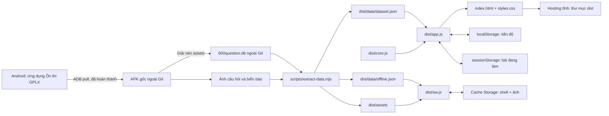
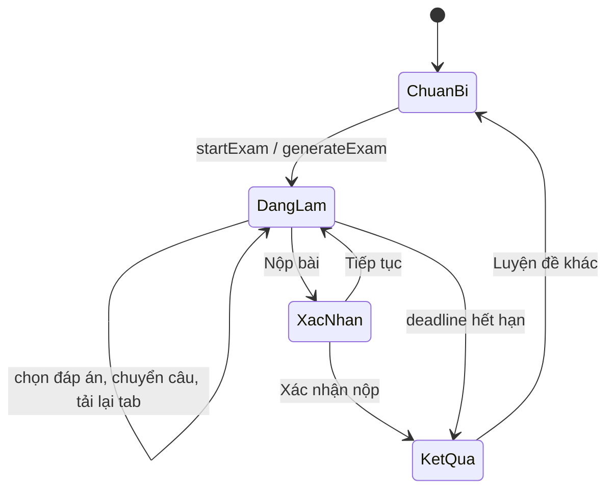

# Bản đồ dự án

## 1. Kiến trúc



Không có server ứng dụng, đăng nhập riêng, cơ sở dữ liệu cloud, API quảng cáo hoặc telemetry. Hosting có thể áp đăng nhập riêng ở lớp nền tảng.

## 2. Cây thư mục

```text
GPLX/                              # Repository này
├── AGENTS.md                       # Điểm bắt đầu cho AI
├── README.md                       # Chạy và sử dụng
├── PROJECT_MAP.md                  # Bản đồ hiện tại
├── DATA_MAP.md                     # Schema, provenance, mapping hạng bằng
├── DESIGN_SYSTEM.md                # Quy tắc giao diện
├── VALIDATION.md                   # Kiểm thử đã chạy và chưa chạy
├── ROADMAP.md                      # Công việc tiếp theo theo thứ tự
├── TIMELINE.md                     # Tiến độ triển khai
├── package.json                    # start/dev/extract/test; không dependency
├── source-report.json              # SHA-256 APK/DB và thống kê snapshot
├── .gitignore                      # Chặn raw APK/DB/token
├── .openai/hosting.json             # ID Sites và dist root
├── .github/workflows/ci.yml         # Kiểm thử khi push/PR
├── scripts/
│   ├── serve.mjs                    # HTTP preview cục bộ, localhost:4173
│   ├── extract-data.mjs             # SQLite + assets → JSON + ảnh + offline manifest
│   ├── check-http.mjs               # Tải toàn bộ tài nguyên qua preview HTTP
│   ├── check-deploy.mjs             # Chặn archive/raw/secret, kiểm tra giới hạn file
│   └── pull-apk.ps1                 # Lấy APK bằng ADB, khi cần tái trích
├── tests/
│   ├── data.test.mjs                # Integrity, sinh đề, chấm điểm, lưu tiến độ
│   └── service-worker.test.mjs      # Worker mô phỏng, offline/failure/retry
└── dist/                           # Mã nguồn runtime; deploy nguyên thư mục
    ├── index.html                  # Shell, navigation, modal, toast
    ├── styles.css                  # Tokens + components + responsive
    ├── app.js                      # UI, router, session, sự kiện
    ├── core.js                     # Hàm thuần có thể unit test
    ├── sw.js                       # Service worker + offline download
    ├── manifest.webmanifest        # PWA identity/install
    ├── icons/                      # SVG + PNG 192/512 tự tạo
    ├── data/
    │   ├── dataset.json            # Nội dung đã chuẩn hóa (commit)
    │   └── offline.json            # Revision dataset + mọi ảnh tham chiếu
    └── assets/
        ├── imageapp_600/           # Ảnh câu hỏi thực sự được sử dụng
        └── signal/                 # Ảnh biển báo
```

Workspace lần đầu: `E:\CODE\GPLX\gplx-pwa` là checkout chứa mã. `E:\CODE\GPLX\source-apk` chứa 5 APK; `E:\CODE\GPLX\extracted\assets` chứa dữ liệu giải nén; `.tools/platform-tools` chứa ADB. Các thư mục này ở ngoài checkout và không cần thiết khi chạy bản clone.

## 3. Bản đồ màn hình → hàm

| Route hash | Màn hình | Hàm render / logic chính |
| --- | --- | --- |
| `#home` | Tổng quan, chủ đề, mục tiêu, ngoại tuyến | `renderHome`, `offlinePanel` |
| `#learn` | Học câu hỏi | `buildStudyList`, `renderStudy`, `questionMarkup`, `renderNumberGrid` |
| `#critical` | Điểm liệt theo bộ hạng | Cùng study, lọc `q.critical` |
| `#wrong` | Câu trả lời sai gần nhất | Cùng study, lọc `progress.answers[id].correct === false` |
| `#saved` | Đánh dấu | Cùng study, lọc bookmark |
| `#signs` | Thư viện biển báo và modal chi tiết | `renderSigns`, action `sign` |
| `#exams` | Chuẩn bị → làm bài → kết quả | `renderExamSetup`, `renderActiveExam`, `renderExamResult` |
| Modal nguồn/cài đặt | Provenance, export/import/reset | `about`, `showModal`, actions export/import/reset |

`go()` đổi route, reset bộ lọc/phiên học và tạo danh sách câu; `render()` chọn màn hình; `updateNav()` cập nhật số lượng. Nội dung nguồn được escape bằng `escape()`.

## 4. Luồng dữ liệu và trạng thái

### Mở ứng dụng

`init()` tải dataset → đọc/kiểm tra tiến độ v1 → khôi phục bài đang làm nếu hợp lệ → chọn route → bật đồng hồ → đăng ký service worker. Lỗi tải dữ liệu hiện thông báo và nút Thử lại.

### Học

`poolFor()` chọn bộ hạng → `buildStudyList()` áp route/chủ đề/từ khóa → người dùng trả lời → `recordAnswer()` ghi đáp án gần nhất → `save()` → render giải thích. `state.responses` chỉ chứa đáp án trong phiên học; lịch sử gần nhất lưu riêng. Chọn Làm lại câu này chỉ mở lại lựa chọn; kết quả cũ còn cho tới khi chọn mới.

Câu sai/đánh dấu dùng snapshot của danh sách trong phiên để việc sửa đúng/bỏ đánh dấu không làm nhảy mất câu đang xem; vào lại route sẽ lấy danh sách mới.

### Luyện đề



`deadline` là timestamp tuyệt đối, không đếm bằng số lần interval. `sessionStorage` giữ ID câu, lựa chọn, vị trí, deadline. Khi nộp, `gradeExam()` chấm điểm, cập nhật câu cần ôn và lưu tối đa 50 bản tóm tắt kết quả. Chi tiết toàn bài vừa nộp chỉ giữ trong bộ nhớ; xem ROADMAP nếu cần lưu lâu dài.

### Ngoại tuyến

Shell được cache khi cài worker. Ảnh đã xem được cache theo yêu cầu. Nút tải offline gửi message `download-offline` → worker đọc manifest → tải theo nhóm 6 → broadcast tiến độ → chỉ ghi dấu `offline-ready` sau khi hoàn tất. Tải gián đoạn có thể thử lại, bỏ qua ảnh đã cache. UI đối chiếu revision để hiển thị trạng thái đã tải.

## 5. Hợp đồng lưu trữ

| Nơi | Khóa | Nội dung / tuổi thọ |
| --- | --- | --- |
| localStorage | `gplx-progress-v1` | version, license, answers, bookmarks, history, lastQuestion |
| sessionStorage | `gplx-active-exam` | Bài đang làm, tồn tại khi tải lại trong cùng tab |
| Cache Storage | `gplx-shell-v1` | Shell + dataset cần để khởi động offline |
| Cache Storage | `gplx-offline-data-v1` | JSON và ảnh, marker revision |

Tiến độ theo origin và trình duyệt. Không tự đồng bộ nhiều thiết bị. Export/import thay thế tiến độ hiện có; import tính lại tính đúng/sai từ dataset đang dùng.

## 6. Muốn sửa gì thì bắt đầu ở đâu?

| Yêu cầu | File/hàm cần xem | Cần kiểm tra |
| --- | --- | --- |
| Màu, font, khoảng cách, responsive | styles.css + DESIGN_SYSTEM.md | 390/700/960/1440px, focus/contrast |
| Menu hoặc route mới | navItems, go, render trong app.js | deep link và menu mobile |
| Sửa quy tắc lọc hạng | core.js poolFor + extract-data pools | DATA_MAP + integrity tests |
| Sửa sinh đề/chấm điểm | core.js generateExam/gradeExam | đủ câu, một điểm liệt, unanswered |
| Học lặp lại, thêm lịch ôn | app.js recordAnswer + core progress schema | migration v1; export/import |
| Đổi bộ dữ liệu | extract-data.mjs + DATA_MAP | ảnh, đáp án, allocations + revision SW |
| Lưu chi tiết lịch sử | app.js finishExam + core parseProgress | giới hạn bộ nhớ và migration |
| Offline không cập nhật | sw.js + offline.json | revision, cache cũ và hosting auth |
| Triển khai | dist + .openai/hosting.json | URL/commit đúng và quyền truy cập |

## 7. Quy trình hoàn tất một thay đổi

Đọc hướng dẫn → sửa đúng module → chạy kiểm thử thích hợp → kiểm tra UI khi công cụ hỗ trợ → cập nhật bản đồ/roadmap → tăng revision shell nếu cần → commit → push đúng remote → xác nhận URL hoặc commit. Những gì chưa kiểm tra phải ghi rõ trong VALIDATION.md.
